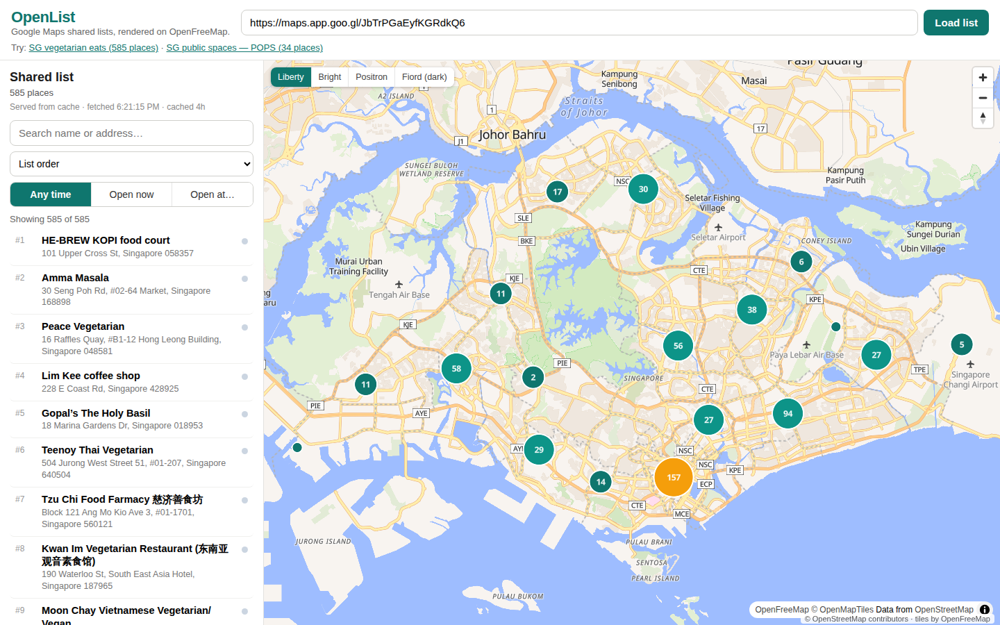
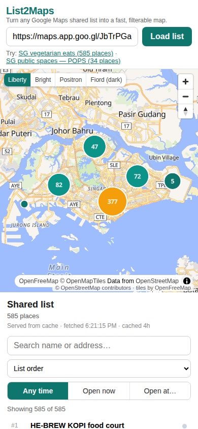

# List2Maps

**Turn any Google Maps shared list into a fast, filterable map.**

Paste a list link — a `maps.app.goo.gl` short link, a `google.com/maps`
list URL, or a bare list id — and get every place on
[OpenFreeMap](https://openfreemap.org/) (MapLibre GL, no API key):
clustered markers, search, country filter, open-now / open-at filters
judged in each place's own local time, GeoJSON + CSV export, and a
shareable `/?list=<link>` URL for the converted list.



No Google account, no API key, no app to install.

## Try it

- [SG vegetarian eats — 585 places](https://maps.app.goo.gl/JbTrPGaEyfKGRdkQ6)
- [SG public spaces (POPS) — 34 places](https://maps.app.goo.gl/pqa6pHk9wDWgr5RP8)

## Features

- **Every place, one call** — a single `getlist` fetch returns the
  whole list: name, address, coordinates, CID and `/g/` feature id.
- **Opening hours on demand** — one `preview/place` call per place,
  fetched lazily when you select a place or use a time filter.
  Places without a `/g/` id (custom pins) stay in the list and are
  marked as having no hours.
- **Time filters that respect timezones** — "Open now" and "Open at
  [time] for [1–6 hours]" are evaluated in each place's local time,
  including overnight hours.
- **Four basemaps** — Liberty, Bright, Positron, Fiord (dark).
- **Export** — the filtered list as GeoJSON or CSV; copy a share link
  for the current list.
- **Mobile-friendly** — map on top, list below, page scrolls, 16px
  inputs so iOS doesn't auto-zoom, no horizontal overflow.


- **Fast repeat visits** — server-side KV cache, stale-while-revalidate:
  fresh for 4 hours, stale served + background refresh for up to 24
  hours.

## How it works

```
Browser ── /api/list?url=<shared list link> ──► Worker
  │                                              ├─ resolve short link
  │                                              │  (maps.app.goo.gl → list id)
  │                                              ├─ getlist: whole list, 1 call
  │                                              └─ KV cache (SWR, 4h fresh)
  └── /api/hours?fid=… ──► Worker ──► preview/place: 7-day hours, 1 call/place
                            └─ KV cache per place (SWR, 4h fresh)
```

Built with [Void](https://void.cloud/) (Vite + React on Cloudflare
Workers). The client is a single page: MapLibre map + list sidebar,
mobile-friendly (map on top, list below, page scrolls).

## Caveats (read this)

- The list and hours come from Google Maps' **undocumented internal
  endpoints**. They're free and keyless, but Google can change or block
  them, and bulk use is against Maps' Terms of Service. The official
  [Places API (New)](https://developers.google.com/maps/documentation/places/web-service)
  is the supported route.
- **Rating, review count and category are not in either response**,
  so the app doesn't show or filter by them.
- Hours are always the **current week**; the 4h cache keeps them
  fresh enough for a day's browsing, not for archival.
- The pb template for place details can go stale: if hours fetches
  start failing across the board, capture a fresh one from any place
  page's `/maps/preview/place` preload link and replace `PB_TEMPLATE`
  in `src/lib/google.ts` (same for the getlist pb — the code already
  falls back to extracting a fresh one from the list page).

## Develop

```sh
npm install
npm run dev        # http://localhost:5173 (Void dev server + local KV)
npm run build      # production build (Worker + client bundles)
npm run typecheck  # tsc --noEmit
```

Local dev note: workerd (the Workers runtime behind `vite dev`)
does its own TLS and can't use the sandbox egress proxy, so live
Google fetches fail in local dev. Two things make local verification
work anyway:

- `scripts/seed-dev.sh` runs the Node harness
  (`scripts/harness/harness.ts`, real fetches via Node) and POSTs the
  resulting KV envelopes to the dev-only `/api/debug-seed` route.
  Re-run it any time you want fresh data in local dev.
- `routes/api/debug-seed.dev.ts` (dev-only, never ships) accepts
  `POST { key, value }` to seed the local KV with a pre-fetched
  envelope.

Two dev gotchas worth knowing:

- Vite's dep optimizer doesn't pre-bundle MapLibre's worker, so in
  dev the worker URL 404s and the map stays blank; `vite.config.ts`
  sets `optimizeDeps.exclude: ['maplibre-gl']` to fix it (production
  build bundles the worker fine either way).
- Google emits exactly `0,0` for places with no coordinates; the
  parser (`parseListEntry`) treats 0,0 as missing, and the client
  (`hasCoords`) double-guards it, or `fitBounds` would span the
  whole world and a marker would sit on null island.

## Deploy

```sh
npx void deploy --platform cloudflare
```

Void opens the browser to sign in to Cloudflare on first deploy,
provisions the KV namespace, and prints the live URL. Later deploys
reuse the saved target. For CI, `void init --github` generates a
workflow (needs a `CLOUDFLARE_API_TOKEN` repo secret).

## Layout

- `pages/index.tsx` — the whole client: MapLibre map, filters, list,
  detail panel, export.
- `pages/index.server.ts` — client-mounted shell (`ssr = false`) +
  loader with the example lists.
- `routes/api/list.ts` — `GET /api/list?url=…`
- `routes/api/hours.ts` — `GET /api/hours?fid=…&name=…&lat=…&lng=…`
- `routes/api/debug-seed.dev.ts` — dev-only KV seeding (see above).
- `scripts/harness/harness.ts` — Node harness: runs the real server
  lib against live Google data and dumps a KV manifest for seeding.
- `scripts/seed-dev.sh` — runs the harness, seeds the dev KV.
- `src/lib/google.ts` — resolve + getlist + preview/place + hours
  parser (ported from the proven Want-to-go regenerate script).
- `src/lib/cache.ts` — SWR over `void/kv` (4h fresh / 24h stale).
- `src/lib/geo.ts` — country + timezone from coordinates.
- `src/lib/time.ts` — open-now / open-at evaluation per timezone.
- `src/lib/hours-client.ts` — client hours fetching + batching.
- `verify-*.png` — screenshot verification captures (real data, both
  example lists).
